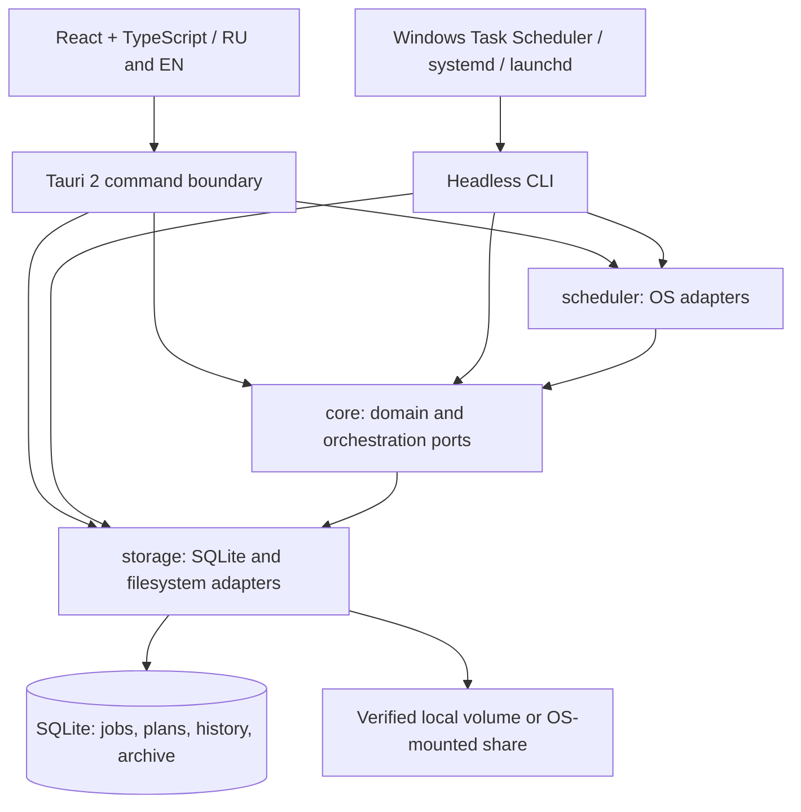

# Architecture — 2026-10-23

Release refresh (2026-10-24): 0.2.0-alpha uses the existing schema 13 and IPC.
Streaming progress allocation now occurs only when publishing an update; copying
and cancellation checks are unchanged. Telegram and HTML email share escaped
report formatting; SMTP includes a plain-text MIME alternative and original subject.
Packaging allowlists tools and notices, and supplies exact Go module source ZIPs.
Graphify extract --code-only --cargo and cluster-only --no-label ran on 2026-10-24:
1049 nodes, 2539 edges, 67 communities. Optional SQL parser remains unavailable;
no extra parser/plugin was installed. Inno Pascal rules are tested natively.

Status: shared backup executor, archive/restore/expiry, job storage, typed Tauri requests and headless scheduling are implemented; release gates remain. All arrows below
describe intended ownership; see Graphify for extracted implementation structure.



This diagram is a design document, not a fallback pretending Graphify failed.
The Graphify graph is stored under `graph/graphify-out/`; its code-only AST and
Cargo extraction covers the actual scaffold, not future GUI/platform adapters.
Reproduce from the repository root (PowerShell; installed environment path):

```powershell
graphify extract . --code-only --cargo --out docs/architecture/graph
graphify cluster-only docs/architecture/graph --no-label
graphify diagnose multigraph --graph docs/architecture/graph/graphify-out/graph.json --json
```

Generation date: 2026-10-20. No LLM API credentials or third-party services are
required for this code-only graph. Read the generation record for actual results.
The updated run generated 785 nodes, 1707 edges and 52 communities. `cluster-only`
generated the report and interactive HTML; community names are automatic numeric
placeholders (`--no-label`), not LLM interpretations. Diagnostics found no missing
or dangling endpoints or collapsed edge pairs; one known C# Escape name-resolution
self-loop remains an extractor artifact.
SQL extraction is incomplete because `tree_sitter_sql` is not installed; no optional
plugin was installed. SQL behavior is checked separately by in-memory tests.

## Boundaries

Alpha packaging (2026-10-20): shared version `0.1.0-alpha` in Cargo, npm and Tauri.
The release script allowlists binaries/docs into clean portable distribution
folders; Inno scripts omit portable.flag/user data and install per-user. Both
languages/architectures use one installed application identity. Uninstall scans
root Task Scheduler entries including hidden tasks, requires the NASBackupManager
prefix, exactly one executable action and an exact installation CLI path. It
disables triggers, rejects active workers, calls the CLI metadata-only maintenance
command via an existing database connection (no CREATE), then removes matched
tasks. Initialization failures abort before application files are removed. Config,
archives and unrelated task entries are preserved. Inno's Pascal code is not
covered by Graphify's AST extractor; native four-variant smoke tests cover it.

Performance refresh (2026-10-20): `safe_join` performs one metadata pass without
cross-operation caching; scan/resource/entry queries reuse SQL bytecode. Visible
activity polling is coalesced and paused while hidden; native progress is ignored
by the hidden React view and tray IPC skips repeated integer percentages.
Contracts/schema remain unchanged. Benchmarks and limits are in ../PERFORMANCE.md;
graph diagnostics in graph/performance-diagnostics.json retain the known C#
Escape self-loop and missing optional SQL parser warning.

Windows packaging supports the default x64 and explicit `-Architecture x86`
(`i686-pc-windows-msvc`) builds. `storage/build.rs` selects the native host platform
from Cargo target architecture and includes it in the shared compilation cache key.
The helper uses the 32-bit Framework compiler (available on both OS architectures)
and a target-sized COM PROPVARIANT. Packaging checks all three PE machine headers
before copying into separate portable folders. No runtime executable extraction or
new dependency versions are introduced. Graph refreshed 2026-10-20; PowerShell
build scripts have no extracted symbols and SQL parsing remains unavailable.
The CLI build now uses Tauri's already locked `static_vcruntime` 3.0.0 helper to
avoid an external VCRUNTIME140.dll dependency; only its existing lock entry is
referenced from the CLI package. Windows 10 provides the dynamically linked UCRT.

Cancellation uses a typed `cancel { id, executionId }` IPC request and a local
`data/activity/<execution UUID>.cancel` marker, verified against the live worker's
token and OS file lock. It works across GUI/CLI processes without a schema change
or a SQLite write competing with the scan transaction. Workers check locally at
bounded intervals and before destructive commits; completed copies/archives remain.
Cancellation is recorded as `interrupted` / `cancelled`, displayed neutrally, and
does not disable the schedule. A stale token cannot stop a subsequent execution.

- `core`: typed jobs, streamed SQLite-backed scans/plans, verified copies, archive/restore/expiry, recovery and guards.
- `storage`: migrations 1–7, local SQLite initialization/settings and OS network/credential adapters.
- `scheduler`: Windows Task Scheduler, systemd-user and launchd registration; no daemon or idle scans.
- `cli`: explicit headless scheduled process entry, shared engine and database.
- `apps/desktop`: Tauri 2 + React UI; typed backup request enum and real progress events.
- `tests`: disposable/in-memory verification. See `safety.md` for release gates.

Core uses rusqlite, serde, UUIDs, streamed SHA-256 verification, filesystem identity/locks and chrono calendar arithmetic. Storage uses bundled SQLite without a database service. Tauri remains at the shell boundary. The shell joins the root workspace and its
existing Cargo.lock. npm/package-lock.json owns frontend dependencies. There is no
background service or NAS polling. A visible UI checks the local database change counter every 5 seconds. Build dependency inventory/notice review is pending.

## Disk and metadata ownership

For a user-selected destination container D, job UUID J owns:
`D/.nas-backup-manager/J/current/`, `archive/<version UUID>/payload/`,
`staging/`, and an ownership marker. The UI must display the actual mirror path.
The archive is a sibling of current, never beneath the mirrored tree.
Existing unrelated destination files are never adopted/removed automatically.

SQLite lives in the OS application-data directory on local storage, not on NAS.
Each connection enables foreign keys; migration SQL and version insertion execute
atomically. WAL/busy timeout policy and recovery must be implemented and tested.
Job removal is a soft delete: archive metadata is protected by RESTRICT foreign
keys. History pruning must retain runs referenced by protected archive versions.

Native paths remain Rust PathBuf internally. IPC uses validated absolute strings;
non-Unicode OS paths must yield an explicit unsupported-path error rather than
lossy conversion or copying the wrong path. Archive relative paths require strict
validation again at use; database constraints are not filesystem authorization.

## Resource model

An on-disk SQLite scan/plan database stores entries keyed by run and relative path;
walk directories incrementally without collecting the full tree or file bodies.
No destructive step starts until the whole source scan succeeds. Deterministic
key ordering gives stable previews; metadata compares size and modification time,
with optional hashes for uncertainty. Integrity decisions need filesystem timestamp
resolution tests; don't promise detection of same-size edits with preserved mtime.

Stream file contents through bounded buffers. Bound in-flight resources by memory,
file-descriptor and device pressure rather than a user-visible transfer quota.
Throttle progress messages, paginate queries with indexed cursors, lazy-load pages.
No work while idle; the OS invokes a headless process for scheduled execution.

## Next implementation slices

1. Toolchain verified; format/lint/model/storage checks passed. SQLite driver and
   shell serialization resolved in Cargo.lock. Complete dependency/license review.
2. Live path/identity verification, SQLite-backed complete scans and dry-run planner.
3. Deterministic fault tests, transactional archive/copy/restore/recovery/retention.
4. Tauri IPC + dark RU/EN UI, real folder picker, preview and explicit consent.
5. OS registration and headless runs, DST/missed-run tests, performance measurements.
6. Build/test Windows candidate; validate Linux/macOS separately; release packaging.


2026-10-19 policy/dashboard update: migration 0003 adds explicit archive mode,
schedule kind/every/anchor, persisted run metrics and bounded file events. IPC adds
Dashboard and FileHistory. Existing jobs retain daily/archive defaults; changing
policy requires fresh preview approval. No-archive never purges prior versions.
Windows registration uses TimeTrigger repetition or CalendarTrigger DaysInterval;
Linux/macOS use native wakeups and a shared calendar gate for N-day schedules.
Metrics/events survive temporary scan/operation metadata pruning. Their retention
is separate from protected archive payloads. The frontend dashboard is lazy-loaded.


2026-10-19 direct-destination/network update: migration 0004 adds destination_layout.
Existing rows default to isolated; new jobs enroll an empty direct destination.
Only .nas-backup-manager at its root is reserved/excluded. No legacy data migration
is performed. Archive/staging stay in that protected service tree; the active data
root is the selected destination itself. Tests exercise both layouts and reject
reserved source paths and adoption of unrelated files.

Removed storage's unused dependency on core; core now calls the storage network
adapter from operation entry points (not per-file verification). That adapter uses
Windows Credential Manager + WNetAddConnection2 through a bounded, hidden,
short-lived OS helper. Only sanitized numeric errors leave the helper. Credentials
travel through stdin; no script/source interpolation of user-controlled values.
IPC adds NetworkStatus / SaveNetworkCredentials / ForgetNetworkCredentials.
The new frontend NetworkAccess view is lazy-loaded. StatusBadge is shared across
jobs, latest run and both history views. Formatter/greeting tests use Node's built-in
runner; tests/ui-check is a separate visual fixture excluded from the production build.


2026-10-19 guest access: NetworkProfile returns only windows/guest/credentials;
SaveGuestNetworkAccess stores an explicitly tagged, zero-byte-secret vault record.
No schema migration or new dependency. Shared reconnect interprets that record as
user guest + String.Empty password (NULL would select the Windows default).
Mode persistence is separate from successful network authentication; security
policy and account-conflict failures are surfaced without changing OS settings.

Migration 5 adds per-job deletion_guard_enabled and deletion_guard_min_files (default true/10). GUI and headless execution share the count-based planner guard. Capacity refresh is event-driven and serializes requests; there is no timer polling.

Migration 6 stores opt-in wake_computer=false. Windows scheduler XML maps it to
WakeToRun; registrations are visible (Hidden=false). Other platforms reject an
unsupported wake request. The desktop observes local SQLite data_version through
a persistent connection and checks every 5 seconds only while visible; a change
refreshes shared job state and summary. There is no NAS polling in the observer.

Migration 7 separates schedule_automatic (configured recurrence vs manual) from
schedule_enabled (actual registration) and schedule_pending (activation after an
approved successful run). Existing registrations retain their mode; inactive jobs
remain manual without automatic activation. Core never registers OS tasks. The
Tauri run handler activates pending recurrence after executor success and reports
schedule registration failure separately from backup success. SQL triggers and
headless guards prohibit scheduled execution of manual-mode jobs. tempfile is an
existing test-only dependency of the desktop crate, with no runtime resource cost.


2026-10-19 activity/notification update: migration 8 adds default-on notification
settings and local job_activity snapshots. A local per-job fs2 lock proves a worker
is alive; readers remove stale rows only with matching tokens. Lock files remain
in place to avoid an unlink/relock inode race. No heartbeat daemon or NAS polling.
Executor snapshots are throttled to 500 ms, UI reads active progress once a second
only while visible. Existing local data_version observer discovers external runs.

Core Feedback coordinates best-effort native presentation for Tauri and the CLI;
notification failures are separate audit events and cannot change a successful
backup result. storage/build.rs compiles native/ActivityHost.cs using the installed
Windows .NET Framework compiler, embeds a small Windows-subsystem executable and
atomically publishes a verified cache copy in the local application state folder.
It hosts a tray icon and uses Windows WinRT toast APIs with an owned AUMID shortcut.
The UTF-8 JSON protocol uses explicit redirected StreamReader/StreamWriter streams;
Console.InputEncoding setters cannot be used in a console-free Windows process.
The host exits on success/owner disappearance, or 30 seconds after an error icon.
No new runtime crate/npm dependency or permanent service was introduced. Windows
uses installed .NET Framework/WinForms and the OS notification center; other OSes
retain progress/UI status, native tray/toasts are not implemented or claimed tested.

Graph regenerated with the commands above: 680 nodes, 1490 edges, 40 communities.
Diagnostic: no missing/dangling endpoints or duplicate edges; one extractor name-resolution self-loop
(SecurityElement.Escape confused with ActivityHost.Escape) is retained. SQL AST extraction remains unavailable because optional
tree_sitter_sql is absent. No dependency was installed for graph generation.


2026-10-19 startup schedule: migration 9 adds schedule_on_login=false. IPC exposes
scheduleKind="startup"; SQL stores daily/1 plus the flag to preserve the existing
CHECK constraints and avoid rebuilding the jobs table or touching backup data.
Core validates startup/1 and clears wake_computer. Windows emits a current-user
LogonTrigger with PT30S delay, InteractiveToken and existing consent/locking gates.
Linux uses user-manager OnStartupSec=30s; macOS uses RunAtLoad. Their runtime
behavior is not verified here. Event triggers have no calendar next-run timestamp.

Graphify refreshed for migration 9 on 2026-10-19 with the recorded extract/cluster commands: 680 nodes, 1490 edges, 40 communities. SQL parser limitation remains.


2026-10-19 verified progress and activation: migration 10 adds verified_bytes and
eta_seconds to local job_activity. Executor reports copying, flushing and streamed
readback separately; integrity verification is preserved. A bounded recent-throughput
window (up to 21 samples / ~10s) estimates remaining byte work, and suppresses ETA
for unknown-duration phases. Active UI/tray percentage never reaches 100 prematurely.
Frontend preserves equal job-page identity on progress-only data_version commits;
Dashboard keeps prior summary data during refresh and allows read-only capacity
measurement while a worker is active.

Native toasts use ToastGeneric + protocol activation with an owned per-user URL
registration, fixed --show argument and a stub ToastActivatorCLSID in the AUMID
shortcut. No URI input is executed. Tray left-click and protocol launch share
path-checked focus-or-open behavior. Existing windows are restored without changing
normal/maximized placement; a short-lived focus helper handles --show launches,
with no permanent IPC server or new runtime dependencies.

Windows implementation references:
- https://learn.microsoft.com/ru-ru/windows/apps/design/shell/tiles-and-notifications/toast-desktop-apps
- https://learn.microsoft.com/en-us/windows/win32/properties/props-system-appusermodel-toastactivatorclsid
Graphify refreshed using the commands above on 2026-10-19: 702 nodes, 1547 edges,
40 communities; optional SQL AST parser remains unavailable.

2026-10-19 window lifecycle: desktop WorkGuard retains the runtime only while an
explicit mutating request is active. Native close hides the same webview during
work; completion checks visibility on the event thread and exits only if hidden
and no workers remain. Normal EXE launches also reuse a path-checked existing
window. Native activation enumerates title-matched HWNDs instead of assuming
Process.MainWindowHandle denotes the application window when hidden.
No IPC/job-schema changes or resident daemon were introduced. Graphify refreshed
with the recorded extract/cluster/diagnose commands: 744 nodes, 1607 edges,
38 communities (2026-10-19); optional SQL parser still absent.

2026-10-20 notification deployment: storage no longer embeds/unpacks the C# EXE
into local settings or the temp activation directory. The build compiles a shared
source/compiler-keyed sidecar per Cargo profile under target/<profile>/native-host,
using an exclusive build lock, and stages it beside the built GUI/CLI. Only its
SHA-256 digest is compiled into storage. Runtime verifies the packaged sibling
nas-backup-notify.exe with a bounded buffer before launching it; no executable is
written at runtime. The portable script copies this required third component.
Existing data/native files are not used, modified or removed. No schema or IPC
change; sha2 reuses the already locked version. Notification registration now
preserves unchanged registry values and owned Start Menu shortcuts.

Graphify extract/cluster/diagnose refreshed with the commands recorded above:
750 nodes, 1617 edges, 42 communities (2026-10-20). Code-only limitations remain.


## Advanced portable preview — 2026-10-23

Migrations 0011/0012 add per-job policy JSON, immutable checksum baselines, verification
results, per-version archive codecs, cloud checksum snapshots and a five-minute quota cache. `advanced` owns
validation, bounded streaming, backoff, rate windows and SHA-256 verification.
`remote` owns explicit age/rclone/curl process adapters. `storage::vault` uses
Windows DPAPI CurrentUser, never SQLite plaintext. Other platforms fail closed
for secret storage pending OS-vault adapters.

IPC adds tool paths, private-key import, integrity verification, safe decryption
export and cached cloud quota. Saved job responses never include secret values.
UI creation/editing use the same typed options; the cloud quota panel is conditional.
No installer or published release payload is rebuilt by this preview work.

Graphify commands above were run 2026-10-23: 905 nodes, 2124 edges, 60 communities;
cluster-only generated HTML/report. Missing optional SQL parser and the pre-existing
C# name-resolution self-loop remain; no missing/dangling edge endpoints. No LLM
service or optional parser was installed. See docs/ADVANCED.md for tested limits.

### Automatic recovery key generation — 2026-10-23

`GenerateIdentity` IPC calls core `remote::generate_identity` on the blocking worker.
The bundled age-keygen creates standard keys; create-new plus sync saves the recovery
file before form state changes. Private identity follows the existing DPAPI save flow.
Graphify code-only/Cargo extraction and cluster-only were run: 925 nodes, 2172 edges,
58 communities. SQL symbols remain unavailable (tree_sitter_sql not installed).

### Managed cloud setup and integrity progress — 2026-10-23

`cloud_setup` owns encrypted rclone configuration, browser authorization timeout,
cancellation and DPAPI connection passwords. Supported providers are OneDrive,
and Dropbox. React CloudSettings is a conditional step after destination,
not a section of advanced policies. IPC exposes prepare/authorize/cancel/status;
no password or OAuth token is returned. Old job JSON gets default connection fields.
IntegrityProgress reports checked bytes, file counts and ETA to job_activity at
most every 400 ms (plus initial/final updates). Zero read rate means unlimited.
Graphify extract --code-only --cargo and cluster-only ran successfully: 963 nodes,
2290 edges, 57 communities; SQL symbols remain unavailable without tree_sitter_sql.

### Cloud provider removal and shared capacity UI — 2026-10-23

Managed connections now allow only OneDrive/Dropbox. Unsupported persisted
connections remain on disk but are rejected by status/validation and process
construction. OAuth completion performs a read-only file API preflight. Process
stderr is bounded and reduced to fixed diagnostic codes without persisting raw text.
`StorageUsage` renders actual local/cloud values; Dashboard coalesces cloud requests,
drops stale responses and offers forced manual refresh above local capacity.

Graphify commands run:
```powershell
& 'C:/Users/PC/Documents/Codex/shared-tools/graphify/Scripts/graphify.exe' extract . --code-only --cargo --out docs/architecture/graph
& 'C:/Users/PC/Documents/Codex/shared-tools/graphify/Scripts/graphify.exe' cluster-only docs/architecture/graph --no-label
```
Result: 972 nodes, 2308 edges, 56 communities. Missing optional SQL parser remains;
sequential extraction was used when parallel extraction was denied by the sandbox.
No external LLM or additional dependency was installed.

### Streaming cloud progress and report formatting — 2026-10-24

`remote::run_progress` drains bounded stderr, accepts rclone JSON statistics and
keeps only the latest sample. Transfer callbacks update the existing Progress / job_activity
contract; active mirror and archive use separate phases. The headless worker and GUI
share these records. No new schema or resident process was introduced. React uses
actual cloud bytes once, with 99% capped while active. Home uses a compact grid.
Feedback associates reports with its run ID; formatting reads settings language,
formats B–TB and the recorded finish time, and safely encodes Unicode SMTP subjects.

Re-ran Graphify code-only/Cargo extraction and cluster-only commands documented above
on 2026-10-24: 994 nodes, 2348 edges, 63 communities. Optional SQL parser still absent.

### Viewport dashboard and shared operation labels — 2026-10-24

OperationLabel centralizes translated operation names and supplemental color tones
across preview, dashboard and file history. Home CSS allocates the viewport to a
flex/grid layout with bounded, keyboard-focusable scroll regions. The existing
20-record dashboard query/50-job pagination are unchanged; no resize listener,
new background requests, schema or IPC change was introduced. Provider labels use
saved cloudProvider values, without guessing from a remote folder name.
Graphify code-only/Cargo extraction and cluster-only commands documented above ran:
996 nodes, 2360 edges, 61 communities; optional SQL symbols remain unavailable.

### Shared notification profile / 0.2.0-alpha — 2026-10-24

Schema 13 adds notification_settings singleton metadata. The core
notification_settings module owns protected blob references, validation, legacy
fallback and explicit per-job import. Updates use a local exclusive lock and an
immutable DPAPI blob, followed by a single SQLite pointer update; secrets never
enter view responses. Tauri IPC exposes notificationSettings/save/import, and the
lazy NotificationSettings UI configures shared destinations. AdvancedSettings keeps
only two per-job channel flags. Headless remote::notify resolves the same profile.
No added daemon, idle polling, network connection or third-party dependency.

Graphify extract --code-only --cargo and cluster-only commands documented above ran
on 2026-10-24: 1037 nodes, 2507 edges, 69 communities. Optional SQL parser is absent.
